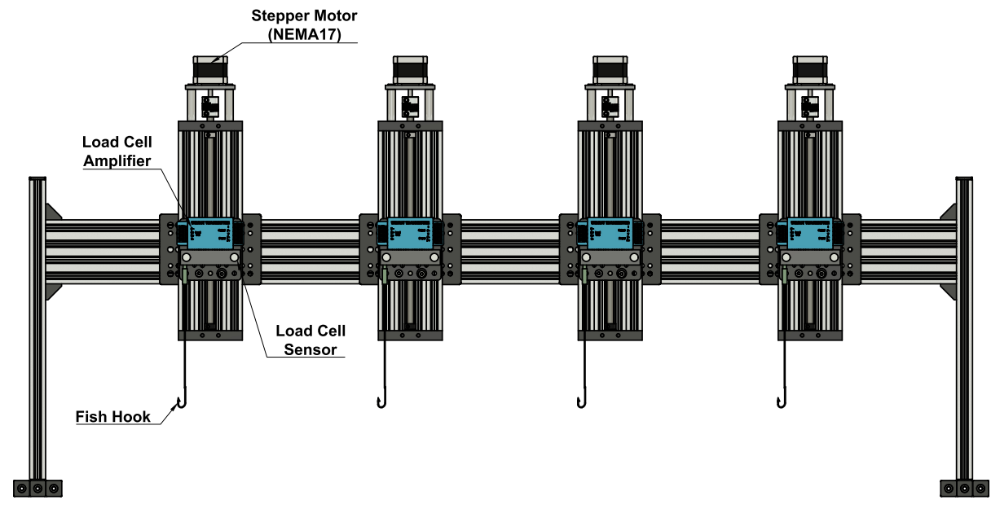
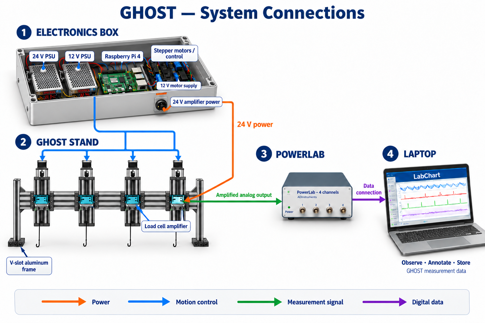

# GHOST

Rigor mortis is the stiffening of muscles after death. As the muscles run out of ATP, the energy needed for muscle relaxation, they become stiff. This stiffness later decreases as muscle proteins break down.

The classical way to monitor rigor mortis in fish is the tail-bending method ([example](https://doi.org/10.1016/j.jfca.2024.106606)). It measures how far the tail drops over the edge of a table. As the fish stiffens, the tail bends less. Tracking these changes requires repeated manual measurements, which take time and can vary with handling and positioning.

GHOST automates repeated measurements by lifting a fish’s tail at one-hour intervals and recording the force required. This reduces manual work and provides a consistent measurement procedure for comparing rigor mortis progression over time and across treatments.

The system was developed by [Michael Axelsson](https://www.researchgate.net/profile/Michael-Axelsson-2).

## How it works

1. **Lifts the tail:** Each fish tail is attached to a fish hook. The linear actuators, controlled by a Raspberry Pi 4, then lift the tails once per hour.
2. **Measures the force:** Load cells sense the force applied during each lift, and amplifiers send the analog signals to a 4-channel PowerLab.
3. **Records the data.** PowerLab transfers measurements to LabChart on a laptop for observation, annotation and storage.

The *electronics box* supplies 12 V to the stepper motors and 24 V to the load-cell amplifiers. 

## Start here

Estimated build cost for the 24 items in the [BOM](hardware/BOM.csv): **12,286.65 SEK / €1,119.79**, excluding PowerLab hardware, LabChart software and VAT.

A future update will develop a microcontroller-based DAQ system to replace PowerLab, LabChart and the weight transmitters. This is planned to reduce the overall build cost and make it more accessible.

The **software** running on the Raspberry Pi 4 will be uploaded to this repository <ins> soon</ins>.

1. Check the [BOM](hardware/BOM.csv).
2. Follow the [assembly guide](docs/assembly.md).
3. Follow the [operation guide](docs/operation.md). 

## Repository layout

| Path | Contents |
|---|---|
| [software/](software/README.md) | Host/controller software and setup status |
| [hardware/](hardware/README.md) | Parts list, wiring and mechanical designs |
| [docs/](docs/README.md) | Assembly, calibration, operation and references |
| [example-data/](example-data/README.md) | Examples and availability |
| [LICENSES/](LICENSES/README.md) | License scope and notices |

## License

This project is licensed under the [MIT License](LICENSE). See [license details](LICENSES/README.md) for scope and third-party notices.
