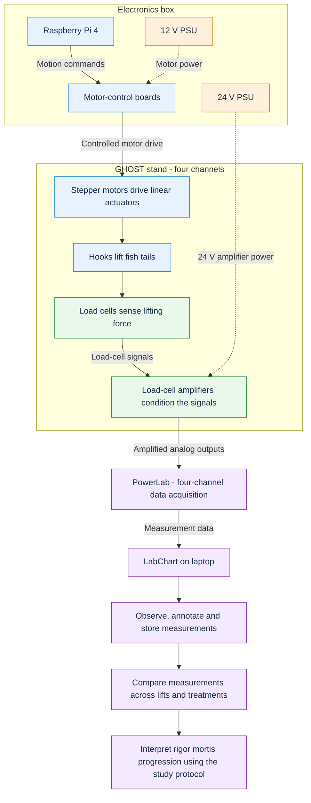

# GHOST system flowchart

GHOST lifts fish tails and records the force during each lift to support monitoring of rigor mortis progression across time and treatments. The motion and measurement chain below applies to each of the four channels.

The intended lift interval is one hour. Exact motion settings and synchronization between actuator motion and acquisition remain undocumented. Power-supply arrows show power delivery; they do not indicate software control or measurement feedback.
